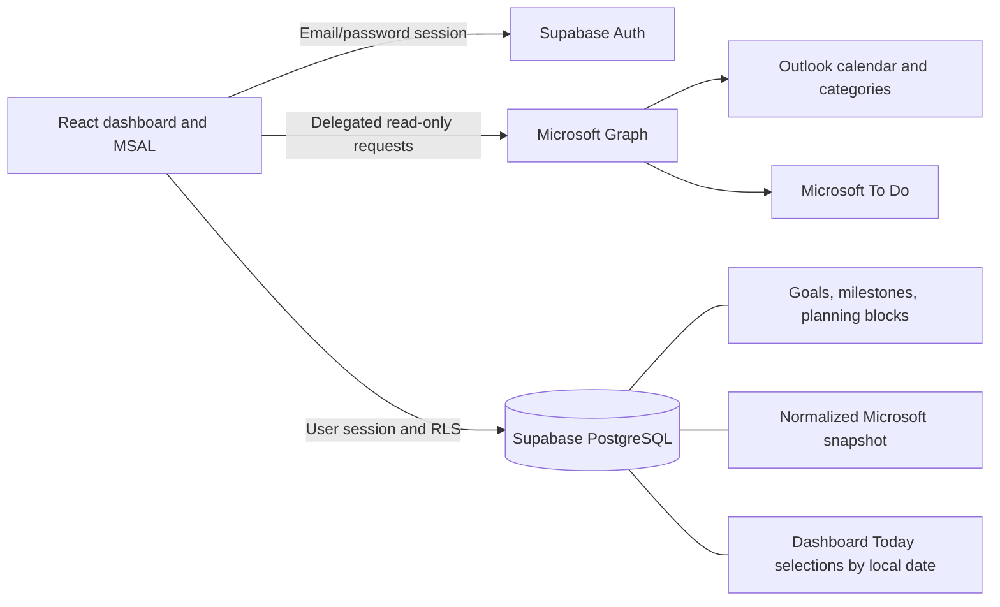

# Niv Command Center

Niv Command Center connects day-to-day execution in Outlook + Microsoft To Do with longer-term goals, milestones, planning blocks and a Gantt timeline. It is for people who like structure and control, but want to keep the bigger picture in view without moving their whole workflow into another productivity ecosystem.

## Why I built it

I wanted to see how the week's commitments connect to longer-term plans. Outlook and Microsoft To Do already handle the daily work, so they remain the source of truth for calendar events and tasks. This dashboard reads them and adds a planning layer: goals describe the direction, milestones mark progress, and planning blocks turn intentions into scheduled time.

Your existing To Do lists can represent different areas of life, such as Work, Study, Personal, Home, Health and Finance. The dashboard brings those lists together without changing them. List classification and colors can be customized in `src/lib/mappings.js`.

**Deploy your own instance:** each installation uses its own Supabase project, Microsoft Entra registration and hosting configuration. There is no shared backend or hosted account supplied with this repository.

## Features

- Weekly Outlook calendar with category colors, all-day events and overlap handling.
- Microsoft To Do filters for Today, Important, Courses and Overdue. Completed tasks are excluded from live reads and the Supabase cache.
- Dashboard Today includes tasks due today plus tasks manually selected for Today inside Niv Command Center. Selections sync across your devices through Supabase; Microsoft To Do itself remains read-only.
- Editable goals, milestones and a yearly Gantt with draggable/resizable date ranges.
- Planning blocks saved in Supabase, optionally linked to tasks. Microsoft data is read-only: blocks do not create Outlook events or change To Do tasks.
- A Supabase cache that lets other signed-in devices read the last successfully synced Microsoft data.
- Persistent Supabase email/password login with password-manager compatible fields.
- Responsive desktop, phone and tablet layouts, plus PWA installation on supported browsers.

## Screenshots

Desktop and mobile/PWA screenshots will be added here.

<!-- Add only sanitized screenshots, then insert their Markdown image links here:
Desktop dashboard: docs/screenshots/desktop-dashboard.png
Mobile/PWA: docs/screenshots/mobile-pwa.png
Optional Gantt/calendar detail: docs/screenshots/planning-detail.png
-->

## Architecture and data flow



1. Supabase sign-in loads your goals, milestones, planning blocks and last Microsoft snapshot under owner-scoped row-level security (RLS).
2. **Connect Microsoft** opens an account-selection popup using authorization code flow with PKCE. Graph reads your default calendar, Outlook category palette and To Do lists.
3. A complete sync replaces the cloud snapshot atomically. Failed writes or older syncs cannot overwrite a newer successful snapshot. Dashboard Today selections are stored separately and survive sync.
4. **Sync now** reads Microsoft again. **Refresh cache** reads Supabase only, including data synced from another device and dashboard-local Today selections.

**Add to Today** selects an open task for your device?s current local calendar date, even without a due date. **Remove from Today** clears that selection; a task due today still appears. Selections refresh on load, cache refresh and tab activation, and expire from the view after local midnight (within 30 seconds while open, or on resume). Stale selections cannot restore completed or missing tasks.

Microsoft tokens stay in browser memory and are never sent to Supabase. The cache stores normalized task/event content, Microsoft identifiers, colors and sync metadata. Check its timestamp: sync is manual and cached data may be stale.

**Stack:** React, Vite, Supabase Auth/PostgreSQL, MSAL Browser, Microsoft Graph, vite-plugin-pwa/Workbox, Node's test runner, PGlite and Playwright. No custom application server is required.

## Local setup

Use Git, Node.js **22.12+** (Node 24 is suitable) and npm. The public repository is **`niv-command-center-public`**; the application name remains **Niv Command Center**.

### 1. Clone and install

```sh
git clone https://github.com/nivfeldman97-lgtm/niv-command-center-public.git
cd niv-command-center-public
npm ci
```

`npm ci` installs the locked dependency tree; `npm install` also works for development. On restricted Windows PowerShell, use `npm.cmd` and `npx.cmd`.

### 2. Set up Supabase

Create your own Supabase project and run migrations **000, 001, 002, 003 and 004**, in that order, in its SQL Editor. Then enable email/password authentication and create a confirmed user with a password. Save your project URL and publishable/anon key for step 4. Follow [SUPABASE_SETUP.md](SUPABASE_SETUP.md) for the exact files and authentication settings.

The app provides sign-in; signup and password-recovery screens are not implemented. A new account starts empty, with no demo data inserted.

### 3. Set up Microsoft (optional)

Create your own Entra app registration and add these **delegated Microsoft Graph permissions**: `User.Read`, `Calendars.Read`, `Tasks.Read`, `MailboxSettings.Read`.

Configure the **Single-page application** platform with `http://localhost:5173/redirect.html`. For organizational and personal account support, choose the corresponding multitenant account type and use `common` as the tenant; a single-tenant deployment can use its own tenant ID. No client secret is used. Follow [MICROSOFT_SETUP.md](MICROSOFT_SETUP.md) for consent and callback setup.

Without Microsoft configuration, Supabase sign-in, goals, milestones and planning blocks still work.

### 4. Create your local configuration

Copy `.env.example` to `.env.local` with your editor, or run:

```powershell
# PowerShell
Copy-Item .env.example .env.local
```

```sh
# macOS/Linux
cp .env.example .env.local
```

Fill in your own values:

| Variable | Value to supply |
| --- | --- |
| `VITE_SUPABASE_URL` | Your Supabase project URL. |
| `VITE_SUPABASE_PUBLISHABLE_KEY` | Your publishable key or legacy anon key. `VITE_SUPABASE_ANON_KEY` is also accepted as a fallback variable. |
| `VITE_MS_CLIENT_ID` | Your Entra application client ID; leave blank if skipping Microsoft. |
| `VITE_MS_TENANT_ID` | `common` or your tenant ID; required when enabling Microsoft. |
| `VITE_MS_REDIRECT_URI` | `http://localhost:5173/redirect.html` locally; your registered HTTPS callback in production. |

All `VITE_` values are embedded in the browser bundle. Never put a service-role key, secret key, client secret, password or token here. `.env.local` is ignored; `.env.example` contains empty values only. Restart Vite or rebuild after changing configuration.

### 5. Run

```sh
npm run dev
```

Open `http://localhost:5173`, sign in with your Supabase user, then optionally connect Microsoft. Create a goal and milestone to start planning. Unknown To Do list names fall back to Personal until you customize the mappings.

For a production build, run `npm run build`; `npm run preview` serves it locally. Use the dev server for Microsoft sign-in unless you also register the preview server's exact callback. See [TESTING.md](TESTING.md) for the isolated unit/database, browser and PWA suites.

## Deploy to Vercel

1. Import your fork of **`niv-command-center-public`** into a **new** Vercel project and select Vite.
2. Use install command `npm ci`, build command `npm run build`, output directory `dist`, and a supported Node version.
3. Set your Supabase and optional Microsoft variables in that project's settings. For Microsoft, register `https://YOUR-DOMAIN/redirect.html` as an Entra SPA redirect and set `VITE_MS_REDIRECT_URI` to that exact URL.
4. Set your Supabase Auth Site URL/allowed redirects for your own host, then deploy again after configuration changes.
5. Verify `/redirect.html`, `/manifest.webmanifest` and `/sw.js` are served as real files. Preserve the cache headers in `vercel.json`.

Other HTTPS static hosts can serve `dist` at the domain root. Subpath hosting needs additional base/scope configuration. Do not rewrite `/redirect.html` to the dashboard or add a COOP header to that callback. See [Vercel's Vite guide](https://vercel.com/docs/frameworks/frontend/vite).

## PWA and mobile

Open your HTTPS deployment and use **Install app** in a supported desktop/Android browser, or **Share > Add to Home Screen** in Safari on iPhone/iPad. Sign in inside the installed app; its session can be separate from the browser's.

The app requires a network connection. Only decorative assets and the manifest are precached, not the application shell, authentication or account data. See [PWA.md](PWA.md).

## Privacy, security and limitations

- RLS protects every application table. Restrictive owner policies and milestone parent-ownership checks isolate users; SQL functions run as the caller.
- Graph requests are GET-only. Microsoft access/refresh tokens remain in MSAL memory; temporary popup state may use sessionStorage. Supabase persists its own login session in browser storage.
- Disconnecting Microsoft clears its local connection but retains the cloud snapshot. Each Supabase user has one snapshot; a successful sync from another Microsoft account replaces it.
- Sync reads the default Outlook calendar over a bounded range. Shared/secondary calendars are not aggregated. Completed tasks disappear after a successful sync, not immediately when changed elsewhere.
- Microsoft Graph for personal To Do accounts does not expose the manual My Day selection used by this project, so Niv Command Center provides its own Today selection layer. It does not read or synchronize Microsoft My Day.
- Fixtures are fictional, and no production configuration or live-account data is included.

## Troubleshooting

- **Supabase not configured:** fill `.env.local` and restart Vite.
- **Sign-in fails:** check that the user has a confirmed email/password identity. There is no signup page.
- **Missing tables/cache errors:** apply all migrations in numeric order, ending with 004.
- **Microsoft popup blocked:** allow popups, especially on Safari/iOS/iPadOS. Close abandoned popups and let any active request time out before retrying.
- **Redirect/consent errors:** check the exact SPA callback, account type, all four delegated permissions and organizational consent rules.
- **Stale tasks/calendar:** use Sync now on a connected device, then Refresh cache elsewhere.

## Contributing

Fork `niv-command-center-public`, create a branch, run the checks and open a pull request. Keep fixtures fictional and never submit credentials or personal data. See [CONTRIBUTING.md](CONTRIBUTING.md).

## License and author

[MIT](LICENSE), copyright (c) 2026 Niv Feldman. Third-party dependencies retain their own licenses. The NC icons and abstract gradient are local geometric assets.
